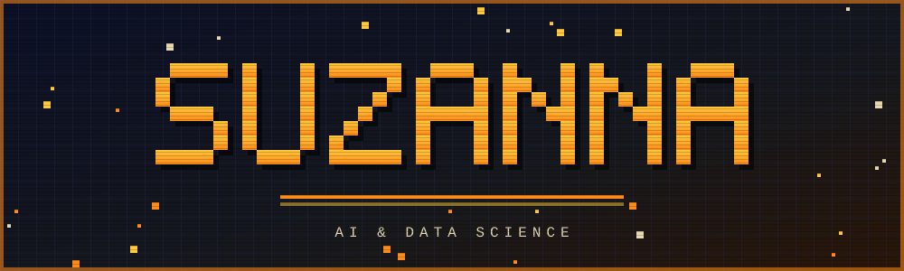
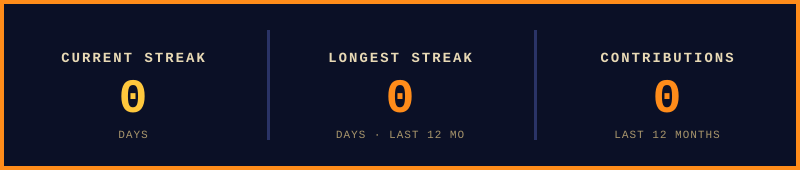

  

 

## About Me

> *Quiet by day, curious all night.*

I'm **Suzanna**, a student in **Artificial Intelligence & Data Science**.
I'm especially passionate about **data engineering** and **machine learning**, and I'm curious about **robotics**.
I'm early in my journey, learning in public, and my first projects are on the way.

## 🎯 Focus Areas

<table>
  <tr>
    <td width="33%" align="center"><h3>🗄️ Data Engineering</h3>Building the pipelines that data flows through</td>
    <td width="33%" align="center"><h3>🤖 Machine Learning</h3>Teaching machines to learn from data</td>
    <td width="33%" align="center"><h3>🦾 Robotics</h3>Curious about where AI meets the physical world</td>
  </tr>
</table>

## 🛠️ Tech Stack

🔥 Streak

  
 

## 🎮 Featured Projects

Nothing to show yet, but my first project is coming soon.

<!-- When you have a project, replace the block above with:
<table>
  <tr>
    <td width="50%" valign="top">
      <h3>▣ Project name</h3>
      
What it does and why.

      
<code>Tech</code> · <code>Stack</code>

      <a href="https://github.com/suzanna24-su/REPO-NAME">View on GitHub</a>
    </td>
  </tr>
</table>
-->

## 🌱 Currently Learning

- 🗄️ Data engineering
- 🤖 Machine learning
- 🦾 Robotics (exploring)

<!-- Edit to match exactly what you're studying right now. -->

## 📫 Connect

**[GitHub · suzanna24-su](https://github.com/suzanna24-su)**

<!-- Add your own links when ready:
**[LinkedIn](https://www.linkedin.com/in/YOUR-HANDLE)** · **[Email](mailto:YOUR-EMAIL)**
-->

 
